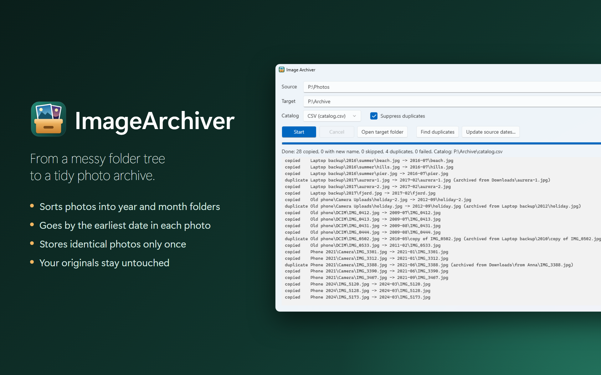

# ImageArchiver

[](https://github.com/kreaton/ImageArchiver/releases/latest)
[](LICENSE)




**Turn a messy folder tree of photos into a tidy archive.**

ImageArchiver copies your JPEG and HEIC photos (`.jpg`, `.jpeg`, `.heic`, `.heif`) into `yyyy-MM` folders, by the smallest date detected for each photo, and records every file in a catalog.

```text
archive/
├── catalog.csv
├── 2004-09/
│   └── a.jpg
└── 2010-05/
    ├── b.jpg
    └── b_1f0c3e52-….jpg
```

## Install

**[Download the installer](https://github.com/kreaton/ImageArchiver/releases/latest/download/ImageArchiver-win-Setup.exe)** and run it. If your PC doesn't have the .NET 10 Desktop Runtime yet, the installer adds it.

The installer isn't code-signed, so Windows may warn you about it. To continue, choose **More info → Run anyway**.

To get a newer version later, click the ⓘ button and choose **Check for updates**. To remove the app, use **Settings → Apps → Installed apps** in Windows.

## How to use it

1. Choose a **Source** folder, where your photos are now.
2. Choose a **Target** folder, where the archive should be.
3. Choose **Start**. Each file is listed as it's handled, and **Cancel** stops after the current file.

Archiving never changes source files, and nothing in the archive is overwritten. Copies are byte-identical, and get the smallest detected date as their created and modified dates. Runs are repeatable: photos already archived are skipped.

Two more modes work on the source alone: a [dry run](#dry-run-finding-duplicates) that reports duplicates, and an [update of the source files' dates](#updating-source-dates).

## Which date is used

The smallest plausible date among:

- EXIF `DateTimeOriginal`, `DateTimeDigitized`, `DateTime`
- GPS date and time, converted to local time
- IPTC `DateCreated`, `DigitalCreationDate`
- XMP `exif:DateTimeOriginal`, `exif:DateTimeDigitized`, `xmp:CreateDate`, `photoshop:DateCreated`, `xmp:ModifyDate`, `xmp:MetadataDate`
- The source file's created and modified dates

That date decides the folder and becomes the copy's created and modified dates. The catalog's `archive_date_source` column says which date won; on a tie, metadata goes before file dates.

GPS time is UTC, while the other dates are local time. It is converted with the photo's own `OffsetTimeOriginal` if it has one, and otherwise with the time zone of the machine running the archive, including the daylight saving of that date. A photo taken abroad without an offset can therefore be some hours off. Dates in XMP marked `Z` are converted the same way. A GPS date without a time stays as it is.

Two rules keep "smallest" from picking wrong dates:

- **Placeholder dates are ignored:** 1601-01-01, 1904-01-01, 1970-01-01 and 1980-01-01, which devices write when they have no real date. So are dates before 1800 and dates in the future. Ignored metadata dates are mentioned in the `note` column.
- **Thumbnail, maker note and ICC profile dates aren't used.** An sRGB profile would otherwise date every photo to 1998.

## What happens to each photo

| Status | Meaning |
| --- | --- |
| `copied` | Archived under its original name |
| `renamed` | Archived as `<name>_<uuid>.<ext>`, because a different file already had that name |
| `skipped` | Already archived from the same relative source path, or already in the archive with unknown origin |
| `duplicate` | Already archived from a different source path, so not copied again |
| `failed` | Could not be processed; the reason is in `note` |

### Duplicates

By default identical content is only ever stored once: a photo is already archived when its SHA-256 hash and size match an archived photo. Suppressed files still get a `duplicate` row in the catalog, so you can see where every file went.

Embedding changes a file's bytes, so a copy made with `archivejpg --xmpembed` or `--exifembed` has a different hash from its original. The hash and size stored in the origin are therefore compared as well, which catches an embedded copy and its untouched original in either order, and two embedded copies of one original. Whichever is processed first is the one stored; files aren't replaced afterwards. The `note` column says when a match came from the stored origin. An origin only counts if it has a full SHA-256 hash and a size.

By unticking **Suppress duplicates** (or with `--keep-duplicates` on the command line) the rules match `archivejpg`: the source's modified date must also be within 2 seconds, compared with the date recorded in the catalog. The same bytes with another modified date count as a new photo and are stored under a new name.

### HEIC files

HEIC files are treated like JPEGs: they are copied as they are and never converted, and no HEIF codec is needed. A file's format is told from its content, so a HEIC named `.jpg` still has its metadata read. Keep in mind:

- **A HEIC and a JPEG of the same photo are both kept.** Their bytes differ, so they aren't duplicates by the rules above, and a JPEG conversion isn't provably the same content.
- **Live Photos:** the `.mov` next to a photo is not archived, or listed in the catalog.

## Dry run: finding duplicates

**Find duplicates**, or `--dry-run` on the command line, scans the source with the same rules and in the same order as archiving with duplicates suppressed, and lists each group of duplicates with the file an archive run would store first. It needs no target and writes nothing, so it doesn't look at any existing archive either.

```text
keep      2004\10\21\scan-017.jpg
duplicate 2004\10\21\copy of scan-017.jpg

keep      2006\07\holiday.jpg
duplicate 2006\07\backup\holiday.jpg
duplicate 2011\old phone\IMG_0412.jpg

Dry run: 194 files scanned, 3 duplicates in 2 groups, 0 failed. Nothing was changed.
```

## Updating source dates

**Update source dates...**, or `--update-source-dates` on the command line, sets each source file's created and modified dates to its smallest detected date, the same date archiving would use. The file contents aren't touched, and files already within 2 seconds of that date are left alone, so running it again changes nothing.

**The previous dates are not kept.** Each change is listed with its old and new dates in the window, or on the command line with `--verbose` or when output is redirected, so this keeps a record:

```bash
imagearchiver "D:\Photos" --update-source-dates > dates-changed.txt
```

With duplicates kept, archiving compares a source's modified date with the one in the catalog. Updating the dates of photos that were already archived makes them count as new photos in that mode. The default mode is unaffected.

## The catalog

One row per processed file, growing across runs; `run_id` tells the runs apart. Later runs read it to recognise what is already archived, so keep it. If it is lost, photos in the date folders are still recognised by their hash, with origin unknown. Both formats are read regardless of which one is being written, so you can switch between runs. A catalog from an earlier version is upgraded to the current columns when it is opened.

If `catalog.csv` is open in a program that locks it, such as Excel, the run stops before copying anything.

The columns are the same in both formats. The SQLite table is `files`.

| Columns | Content |
| --- | --- |
| `run_id`, `processed_at`, `status`, `note` | The run and the outcome |
| `source_root`, `source_path`, `target_path`, `existing_source_path` | Paths; the last is where an already archived copy came from |
| `size`, `sha256`, `file_created`, `file_modified` | The source file |
| `archive_date`, `archive_date_source` | The date that decided the folder, and where it came from |
| `exif_date_*`, `exif_offset_time_original`, `gps_date_time_utc`, `iptc_*`, `xmp_*` | Every date found, as stored in the photo |
| `gps_date_time_local` | The GPS date and time, converted to local time |
| `make`, `model`, `lens_model`, `software` | Equipment |
| `orientation`, `width`, `height` | Picture |
| `exposure_time`, `f_number`, `iso`, `focal_length`, `flash` | Exposure |
| `artist`, `copyright`, `description` | Descriptions |
| `gps_latitude`, `gps_longitude`, `gps_altitude` | Position in signed decimal degrees, and metres |
| `origin_method`, `origin_source_root`, `origin_source_path`, `origin_sha256`, `origin_size`, `origin_archived_at` | The origin `archivejpg` stored with the source, see below |
| `metadata_all` | All EXIF, IPTC and XMP fields as `Group/Tag=value; …` |

**The catalog can contain private details.** With GPS data, it lists where your photos were taken, in one easily shared file.

### Origin information

`archivejpg` could store a photo's origin in the file itself or in a sidecar. Here the catalog holds it instead, and the copies stay byte-identical:

| `archivejpg` stored | Catalog column |
| --- | --- |
| `SourceRoot` | `source_root` |
| `SourcePath` | `source_path` |
| `OriginalSHA256` | `sha256` |
| `OriginalSize` | `size` |
| `ArchivedAt` | `processed_at` |

Photos that already carry such an origin keep it. If a source photo has it in embedded XMP (`--xmpembed`), in the EXIF `UserComment` (`--exifembed`) or in a `<name>.jpg.xmp` file next to it (`--xmpsidecar`), it goes into the `origin_*` columns, with `origin_method` listing where it was found. If there are several, the values come from the first in that order. Sidecars aren't copied, as the catalog has their information.

The stored origin also counts when looking for duplicates, see [Duplicates](#duplicates).

## Differences from archivejpg

ImageArchiver is a .NET 10 take on the Rust `archivejpg`.

- `yyyy-MM` folders instead of `yyyy/MM/dd`.
- The smallest of all detected dates instead of `DateTimeOriginal`, then `DateTime`, and copies carry that date instead of the original's modified date.
- Identical content is stored once by default.
- One catalog instead of a manifest per run plus a log.
- No `--xmpembed`, `--exifembed` or `--xmpsidecar`: the catalog holds that information.
- An archive made by `archivejpg` is not recognised as already archived, because of the different layout and catalog.

---

## For developers

| Project | What it is |
| --- | --- |
| `ImageArchiver.Core` | The DLL with all the logic: `Archiver.Run(options, progress, cancellation)` |
| `ImageArchiver.Cli` | Command line, `imagearchiver.exe` |
| `ImageArchiver.Wpf` | Windows GUI, `ImageArchiverWpf.exe` |
| `ImageArchiver.Tests` | xUnit tests, which generate their own JPEG and HEIC files |

The app uses [MetadataExtractor](https://github.com/drewnoakes/metadata-extractor-dotnet) to read photo metadata and [Microsoft.Data.Sqlite](https://learn.microsoft.com/dotnet/standard/data/sqlite/) for the SQLite catalog. Installs and updates use [Velopack](https://velopack.io).

### Build and test

You need the [.NET 10 SDK](https://dotnet.microsoft.com/download).

```bash
dotnet build ImageArchiver.slnx
```

```bash
dotnet test ImageArchiver.Tests
```

### Command line

The installer only includes the Windows app. To use the command line, build `ImageArchiver.Cli`, or run it from source:

```bash
dotnet run --project ImageArchiver.Cli -- "D:\Photos" "E:\Archive"
```

```text
imagearchiver <source> <target> [--catalog Csv|Sqlite] [--keep-duplicates] [-v|--verbose]
imagearchiver <source> --dry-run [-v|--verbose]
imagearchiver <source> --update-source-dates [-v|--verbose]
```

| Option | Description |
| --- | --- |
| `--catalog` | `Csv` writes `catalog.csv` (default), `Sqlite` writes `catalog.db` |
| `--keep-duplicates` | Store the same content again when its modified date differs, as `archivejpg` does. By default identical content is stored once |
| `--dry-run` | Only report the duplicates in the source. Nothing is copied or changed |
| `--update-source-dates` | Only set each source file's created and modified dates to its smallest detected date |
| `-v`, `--verbose` | Print a line for every file. Also the behaviour when output is redirected |

A progress bar shows while it runs. Ctrl+C stops after the current file.

| Exit code | Meaning |
| --- | --- |
| `0` | All photos were handled |
| `1` | At least one photo failed, or the run could not start |
| `2` | Invalid arguments |
| `130` | Cancelled |

### Releases

Every push to `main` runs the tests, builds the app on GitHub Actions and publishes a new release, one patch version higher than the last (`.github/workflows/release.yml`). To push without releasing, add `[skip ci]` to the commit message. You can also start a release by hand from the repository's Actions tab, or run `ImageArchiver.Wpf\BuildRelease.ps1` locally. Add `-LocalOnly` to build without uploading.

The repository must stay public, because **Check for updates** reads its releases without logging in.
